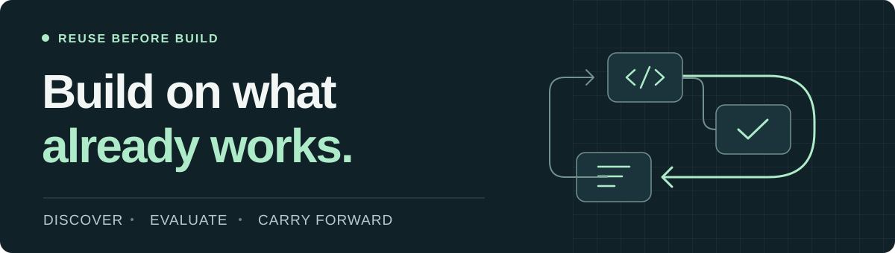

<h1 align="center">reuse-before-build</h1>

<p align="center">
  <a href="LICENSE"></a>
  <a href="https://agentskills.io/specification"></a>
  <a href="https://github.com/Ai-Eastern/reuse-before-build/commits/main/"></a>
</p>

<p align="center"><strong>一个 Agent Skill：让编码 Agent 在写新代码之前，先找已有的代码、测试和库来复用。</strong></p>
<p align="center">适用于 Claude Code、Codex 等支持 Agent Skills 的 Agent · 无需服务 · 无运行时依赖</p>

[English](README.md) · [安装](#安装) · [试用](#试用) · [工作方式](#工作方式) · [实际结果](#实际结果) · [工具兼容](docs/compatibility.md)

编码 Agent 常会在已有的辅助函数旁边再写一个，加一些并没有多验证什么的测试，或者推荐一个没人读过代码和许可证的库。这个 Skill 在动手前加一道检查：Agent 依次查找你的项目、标准库和已安装的依赖，只有确实还有缺口时，才去查 GitHub 和官方来源；然后依据实际读过的内容，决定 **Take**（直接用）、**Borrow**（改一改再用）还是 **Build**（只写缺的部分）。

## 用起来有什么不同

同一个任务、同一个项目，分别在不加载和加载 Skill 时运行（GPT-5.6 Luna，2026-09-21；[报告](evals/results/2026-09-21/luna-search-timing/REPORT.md)）：

```text
要求      确保 retry 首次成功时立即返回、不再调用 operation，保持生产代码不变。
不加载    修改测试文件来"强化"首次成功的用例：产生了改动，但没有新增覆盖。
加载后    指出现有断言 seen == [1] 已经证明只调用一次，不改任何文件，并运行现有测试。
```

## 何时使用

- **适合：** 选择库、框架或架构；实现可能已经存在的功能或辅助函数；新增或检查测试；接手交接过来的工作。
- **不需要：** 改错别字、重命名等小改动，Skill 对它们只做简单的本地检查。
- **如何调用：** 在请求里提到 `reuse-before-build`。有些 Agent 会在任务匹配时自动加载；第一次用时建议明确点名，确认它已加载。

## 安装

把 [`skills/reuse-before-build`](skills/reuse-before-build/SKILL.md) 文件夹复制到 Agent 的 skills 目录。请复制整个文件夹：`SKILL.md` 需要时会读取 `references/` 里的文件。

**Claude Code**，对所有项目生效（只想对一个项目生效时，改为复制到该项目的 `.claude/skills/`）：

```bash
git clone --depth 1 https://github.com/Ai-Eastern/reuse-before-build.git /tmp/reuse-before-build
```

```bash
cp -R /tmp/reuse-before-build/skills/reuse-before-build ~/.claude/skills/
```

**Codex 和其他 Agent**，用 skills CLI 安装（在你的项目目录下执行，需要 Node.js ≥22.20.0）：

```bash
npx skills@1.7.0 add Ai-Eastern/reuse-before-build --skill reuse-before-build --agent codex --copy -y
```

把 `codex` 换成 `claude-code` 或其他 Agent 名称即可。GitHub Copilot CLI、Cursor、Gemini CLI、OpenCode、Windsurf 的安装路径，以及 Windows 下的命令，见[兼容指南](docs/compatibility.md#manual-installation)。

## 试用

```text
使用 reuse-before-build，给已有 HTTP 客户端增加重试支持。
先检查已有代码、测试和相关决策。
修改前说明：哪些成果可以复用、哪些结论需要验证，以及最小下一步。
```

如果当前任务是架构设计：

```text
使用 reuse-before-build，为新项目设计持久化 webhook 投递。
现有成果不足时，查找 GitHub 和官方仓库中的实现。
说明哪些可以直接复用、借鉴适配或自行补齐，以及它们如何影响架构。
本次只做设计，不安装依赖或编写实现代码。
```

好的回答会先说明它实际读了哪些文件或来源，再作决定。想先练手，可以用仓库里的 [retry-service 练习项目](evals/fixtures/retry-service/README.md)。加载不了时，参照[排查说明](docs/compatibility.md#troubleshooting)。

## 工作方式

**先找已有成果 → 核对是否真正适用 → 选择最小范围 → 验证。**

| 决策 | 何时 | 接下来做什么 |
| --- | --- | --- |
| **Take · 直接复用** | 已有成果已经满足需求 | 直接使用，并运行相关检查 |
| **Borrow · 借鉴适配** | 已有代码、测试或模式稍加调整即可适用 | 说明复用了什么，做最小改动 |
| **Build · 自行补齐** | 检索后没有合理可用的方案 | 只补缺失部分，并记录否决的选项 |
| **Blocked · 受阻** | 决策依赖的事实无法获得 | 说明缺什么，继续做不受影响的工作 |
| **Needs human approval · 需要批准** | 下一步超出你已授权的范围 | 准备好方案，先征求同意 |

- **先查本地。** 只有出现真实的能力或兼容性缺口，才去外部查找；新会话、新文件或测试失败，都不是重新检索的理由。
- **凭证据，不凭印象。** 采用外部库之前，Agent 会固定一个版本，读它的清单、许可证、实现，以及一个测试或调用位置。没能读到的部分，一律标为"未核实"。
- **先用现有测试。** 先读现有的测试运行器和断言，只为真实缺口扩展测试，已覆盖的行为不重复加。
- **接续时先核对。** 交接记录或旧的测试结果只是需要和当前工作区核对的说法，不能授予新的权限。

完整规则在 [`SKILL.md`](skills/reuse-before-build/SKILL.md) 里；检查外部库和编写检查点的细节，分别在 [external-candidates.md](skills/reuse-before-build/references/external-candidates.md) 和 [checkpoints.md](skills/reuse-before-build/references/checkpoints.md) 里。

## 实际结果

| 检查内容 | 观察到的结果 | 详情 |
| --- | --- | --- |
| **当前版本与上一版对比**：Claude Opus 5.5，2026-10-11 | 8 个场景、17 次运行，两个版本通过了全部检查，精简后的新版没有退化。证据完整时，新版仍会采用合适的库，而不是一律拦下。 | [报告](evals/results/2026-10-11/claude-restructure/REPORT.md) |
| **加载与不加载 Skill 对比**：早期版本，GPT-5.6 Luna，2026-09-21 | 17 次运行，含不加载 Skill 的对照组。加载后，Agent 不再改动已经足够的测试，新写的断言能抓住故意写错的实现。 | [报告](evals/results/2026-09-21/luna-search-timing/REPORT.md) |
| **已知弱点**：外部库核查 | 早期版本有时在读源码和许可证之前就推荐了库：上一行中的两次架构试跑都是这样；V12 在 Codex 应用里"只有响应头"的 3 次运行中也有 2 次（不加载 Skill 的对照组同样是 2 次）。在 Claude 上，当前版本把这种库正确标为未核实；Codex 上尚未复测。 | [报告](evals/results/2026-09-26/native-host/REPORT.md) |

每一行都是单一模型上的小样本，不是成功率。更早的开发轮次（V10–V13，Codex）、方法和文件哈希见[验证说明](docs/validation.md)。

## 与其他 Skill 配合使用

与 ponytail 等精简类 Skill 同用时，两者共享一次复用决策和一套验证计划；已有测试足够就直接用，精简实现时不丢掉必要的证据。详见[协作规则](docs/compatibility.md#combining-workflow-skills)。

## 示例与贡献

- **从具体任务开始：** [为架构发现已有实现](examples/architecture-reuse-example.md)、[复用代码](examples/take-example.md)、[适配代码](examples/borrow-example.md)、[补齐实现](examples/build-example.md)、[复用测试](examples/test-reuse-example.md)、[接续工作](examples/resume-example.md)。
- **了解决策边界：** [证据不足](examples/blocked-example.md)、[授权边界](examples/needs-approval-example.md)。这些是说明性示例，实际运行记录见上方。
- **帮助改进：** [提交可复现案例](https://github.com/Ai-Eastern/reuse-before-build/issues/new/choose)、验证一种工具，或[运行评估](evals/README.md)。请附上修订、宿主与模型、任务、预期结果和脱敏证据。

<details>
<summary>范围与限制</summary>

这是指令工作流，效果取决于宿主和模型。它不增加工具、不提供运行时强制拦截，也不保证降低成本。外部检索需要 Agent 已有的网络能力；证据检查不能替代安全或法律审查。

接续只覆盖当前任务的工程状态，不索引无关对话、不提供全局记忆、不授予额外权限。示例和评估资产均为可选；Skill 本身就是 [`skills/reuse-before-build`](skills/reuse-before-build/SKILL.md) 文件夹。

</details>

[MIT](LICENSE) · 再分发时请保留版权和许可声明。
